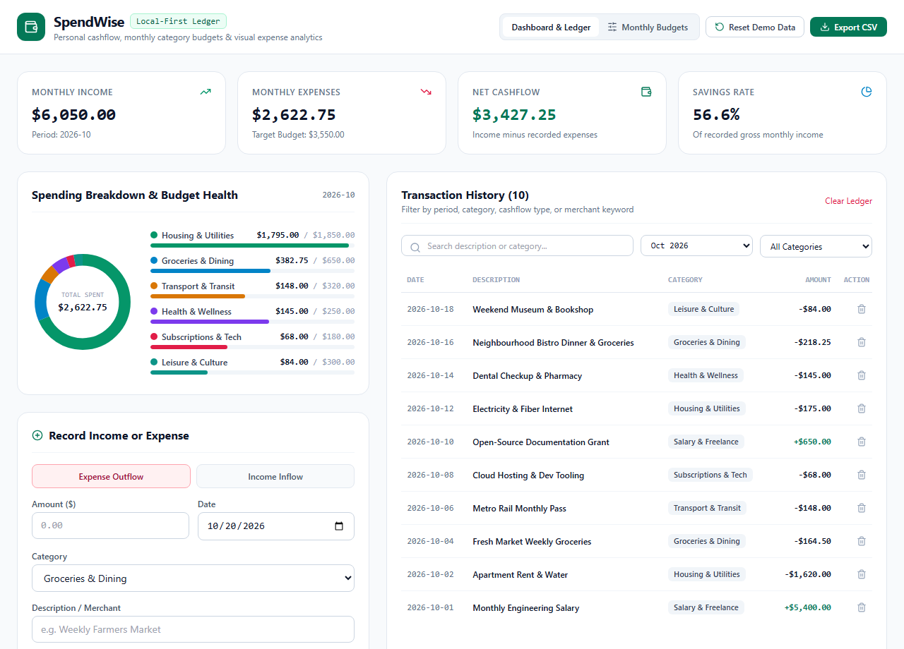
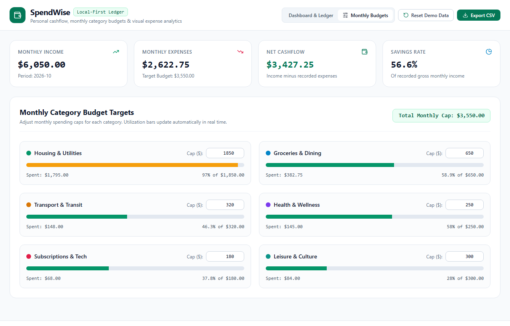
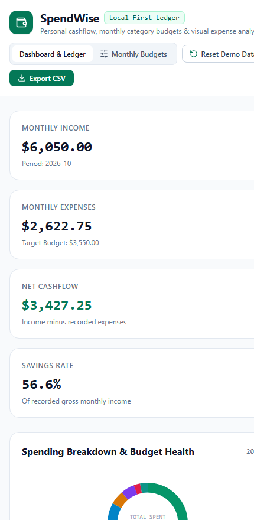

# SpendWise — Local-First Personal Finance & Budget Ledger

[](https://opensource.org/licenses/MIT)
[](https://www.typescriptlang.org/)
[](https://react.dev/)
[](https://github.com/iamnarace/spendwise/actions/workflows/ci.yml)

**SpendWise** is a privacy-friendly personal expense and monthly budget tracking application that helps you record income and expenses, monitor category budget utilization, visualize spending breakdowns, filter transaction history, and export RFC 4180 CSV reports—all stored locally in your browser.

---

## Why SpendWise?

Many personal finance apps require linking bank accounts, paying monthly subscriptions, or storing personal transaction histories on third-party servers. **SpendWise** gives individuals a fast, transparent, zero-account ledger that runs entirely in the browser using `localStorage`, complete with instant CSV export and a resettable demonstration dataset.

---

## Key Features

- **Income & Expense Recording:** Log inflows and outflows with date, category, merchant description, and dollar amounts.
- **Monthly Category Budgets:** Configure custom monthly spending caps across six core expense categories (`Housing & Utilities`, `Groceries & Dining`, `Transport & Transit`, `Health & Wellness`, `Subscriptions & Tech`, and `Leisure & Culture`) with color-coded progress bars.
- **Interactive SVG Spending Analytics:** Real-time SVG donut chart and category utilization breakdown alongside Monthly Income, Monthly Expenses, Net Cashflow, and Savings Rate KPIs.
- **Multi-Faceted Ledger Filtering:** Filter transactions by dynamically derived transaction months (sorted newest-first across any year/month range, or `All Dates`), category, or live keyword search.
- **RFC 4180 CSV Export with Formula Injection Protection:** Download your currently filtered transaction ledger as a standard `.csv` spreadsheet file with RFC 4180 quote/newline escaping and automatic neutralization of dangerous spreadsheet formula prefixes (`=`, `+`, `-`, `@`, `\t`, `\r`, `|`).
- **Resettable Demo Mode:** Preloaded with realistic October 2026 sample transactions so you can explore charts and budgets immediately, plus one-click **Reset Demo Data** or **Clear Ledger** controls.

---

## Screenshots

### Desktop — Cashflow Dashboard, SVG Spending Chart & Transaction Ledger


### Feature View — Monthly Category Budget Configurator


### Mobile Responsive View
<p align="left">
  
</p>

---

## Technology Stack

- **Frontend:** React 18 + TypeScript 5
- **Styling:** Tailwind CSS (Emerald & Slate financial ledger theme)
- **Charts:** Custom zero-dependency SVG Donut & Progress Visualization
- **Icons:** Lucide React
- **Build & Testing:** Vite 6, Vitest 4, React Testing Library, ESLint

---

## Requirements & Installation

- **Node.js:** v20+ LTS recommended (v18.18+ supported for build/runtime)
- **npm:** v9+

```bash
# Clone the repository
git clone https://github.com/iamnarace/spendwise.git
cd spendwise

# Install dependencies
npm install
```

---

## Local Development, Build & Testing

```bash
# Start local development server
npm run dev

# Run ESLint check
npm run lint

# Run Vitest automated unit & UI tests
npm test

# Build production bundle
npm run build
```

---

## Usage Guide

1. **Explore the Demo Ledger:** Launch the app to inspect the preloaded October 2026 cashflow summary, category donut chart, and transaction table.
2. **Record a Transaction:** Use the **Record Income or Expense** form on the left to log a new expense or income item.
3. **Adjust Monthly Budgets:** Click **Monthly Budgets** in the top navigation bar to customize dollar caps per category and observe utilization percentages update live.
4. **Filter & Export:** Use the search bar, month dropdown, or category selector to narrow down transactions, then click **Export CSV** to download a spreadsheet copy.

---

## Project Structure

```text
spendwise/
├── .github/
│   ├── ISSUE_TEMPLATE/
│   ├── workflows/ci.yml
│   └── pull_request_template.md
├── docs/
│   └── screenshots/
├── src/
│   ├── test/
│   │   ├── financeEngine.test.tsx
│   │   └── setup.ts
│   ├── utils/
│   │   └── financeEngine.ts
│   ├── App.tsx
│   ├── index.css
│   └── main.tsx
├── CHANGELOG.md
├── CONTRIBUTING.md
├── LICENSE
├── SECURITY.md
├── package.json
└── vite.config.ts
```

---

## Security, Privacy & Financial Disclaimer

- **Local-Only Storage Limitations:** All transactions and budget targets are saved in your browser's `localStorage`. Clearing browser cache/site data or using private browsing windows will remove stored records unless you export them via **Export CSV**.
- **No Financial Advice:** SpendWise is an educational and personal record-keeping utility. Summaries, savings rates, and budget indicators are mathematical calculations of user-entered numbers and do not constitute financial, investment, tax, or legal advice.

---

## Known Limitations

- **Single Currency Display:** Amounts are formatted in standard `$` (`en-US`) notation without multi-currency exchange rate conversion.
- **No Automated Bank Feeds:** Transactions are entered manually to preserve 100% client-side privacy.

---

## Roadmap

- [ ] CSV file import & column mapper
- [ ] Recurring monthly transaction templates
- [ ] Multi-currency symbol selector (`$`, `€`, `£`, `¥`, `A$`)
- [ ] Year-over-year monthly bar chart comparison

---

## Contributing

Contributions are welcome! Please read [CONTRIBUTING.md](./CONTRIBUTING.md) before submitting a pull request.

---

## Acknowledgements

Developed with assistance from Google Antigravity.

---

## License

Licensed under the [MIT License](./LICENSE). Copyright (c) 2026 Naresh Adhikari.
